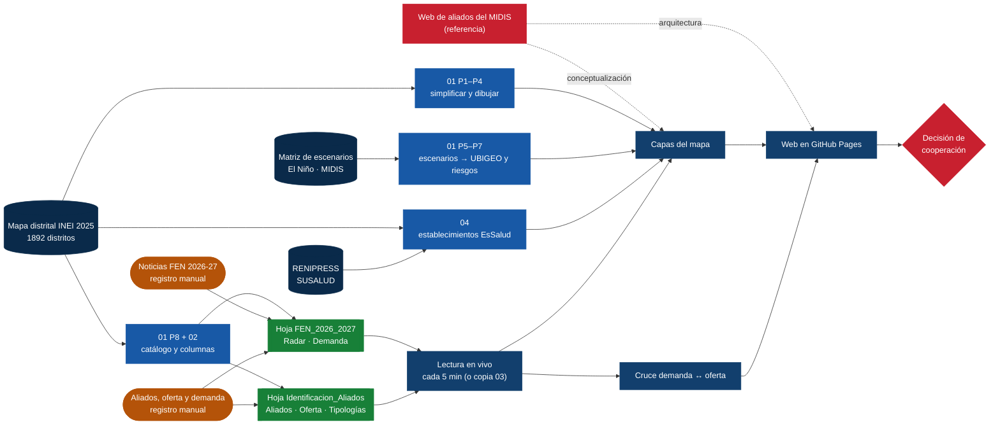

# Aliados y cooperación ante el Fenómeno El Niño 2026-2027 · EsSalud

Web de la oficina de cooperación internacional de EsSalud para buscar cooperación ante el FEN 2026-2027. Responde a una decisión: **a qué aliado pedir qué apoyo, y para qué zona**.

Web publicada: https://diegosimemirror.github.io/aliados/ (GitHub Pages, rama `main`).

> **Referencia.** La arquitectura y la conceptualización de esta web siguen el **[Mapa de Aliados Estratégicos ante emergencias y Fenómeno El Niño del MIDIS](https://claude.ai/artifact/XCFnRvFZUEnCZ79exZgucG)**. De esa web vienen la estructura de secciones, el mapa con aliados por departamento, el filtro por tipología, las tipologías Donante, Voluntario, Logístico y Articulador, los niveles de emergencia del SINAGERD y la lectura en vivo desde Google Sheets. Se reconoce como el modelo que se siguió.

## Qué muestra

| Sección | Qué contiene | De dónde sale |
| --- | --- | --- |
| Mapa | Perú con 1892 distritos. Capas **FEN histórico** (azul, por probabilidad) y **FEN 2026-27** (naranja, por afectación), con franjas donde coinciden. Filtro por **tipo de riesgo**: al elegir uno, el mapa pinta solo ese riesgo con su color. Puntos de los **establecimientos de EsSalud** (llenos si están en un distrito con riesgo). Círculos con el número de aliados por departamento | Mapa INEI 2025, matriz de escenarios, RENIPRESS y hojas de Google |
| Riesgos asociados al FEN | Siete tipos de riesgo, cada uno con su mini mapa, qué es, cómo se relaciona con El Niño y su periodo crítico | `datos/fuentes/riesgos_fen.csv` + matriz |
| FEN histórico | 23 escenarios: zonas que suelen ser las más afectadas por El Niño | `Matriz_Escenarios_El_Nino_2026-2027_MIDIS.xlsx` |
| Radar 2026-27 | Noticias sobre dónde está afectando el FEN 2026-27 | Hoja [FEN_2026_2027](https://docs.google.com/spreadsheets/d/1YE-9gXDLxJOuHyfflAFxznstzzi1sihIF3RiLt6zp5c/edit) › Radar |
| Demanda | Necesidades de cooperación por zona y aliados cuya oferta coincide | Hoja FEN_2026_2027 › Demanda + oferta de aliados |
| Aliados | Directorio con tipologías, oferta y cobertura | Hoja [Identificacion_Aliados_Essalud](https://docs.google.com/spreadsheets/d/1NYboI4a8f3SYIUpmPrKBunqqmcSTwwL6GylItubkLIE/edit) › Aliados y Oferta |
| Niveles y Tipologías | Niveles SINAGERD y definiciones de cada tipo de aliado | Web del MIDIS + pestaña Tipologias |

## Tipos de riesgo del FEN

| Riesgo | Color | Escenarios de la matriz | Distritos | Fenómenos del radar que entran aquí |
| --- | --- | --- | --- | --- |
| Lluvias intensas e inundaciones | azul | 1–4, 6–9, 11–14 | 282 | Lluvias intensas; Inundación o desborde de río |
| Huaicos y deslizamientos | marrón | 1–16 | 481 | Huaico o deslizamiento; Activación de quebradas |
| Sequía y déficit hídrico | ocre | 17–20 | 270 | Sequía o déficit hídrico; Vaciante de ríos amazónicos |
| Calor extremo e incendios forestales | rosa | 20, 22 | 52 | Calor extremo; Incendio forestal |
| Heladas y friaje | celeste | 17–19 | 218 | Heladas o friaje |
| Mar cálido y oleaje anómalo | verde | 4, 21 | 14 | Mar cálido u oleaje anómalo |
| Dengue y otras epidemias | morado | 23 | 8 | Dengue; Otra enfermedad (EDA, leptospirosis, IRA) |

- **De dónde salen:** cada escenario se clasificó según su columna «Fenómeno natural», en `datos/fuentes/escenarios_riesgos.csv`, que se puede editar.
- **Textos:** las definiciones y periodos críticos están en `datos/fuentes/riesgos_fen.csv` y se basan en el calendario crítico de la matriz.
- **Colores:** se validaron con el script de la guía dataviz como pares vecinos de la leyenda. Nunca aparecen los siete en un mismo mapa: en el mapa grande se ve un riesgo a la vez, y en la sección «Riesgos» cada uno tiene su propio mapa. Por eso cada color va acompañado siempre de su ícono y su nombre.

## Establecimientos de EsSalud

- **Fuente:** RENIPRESS de SUSALUD al 30/10/2026, con 36 246 IPRESS, de las cuales 495 son de EsSalud.
- **Se publican solo los 409 activos.** Se excluyen 65 dados de baja definitiva y 21 de baja provisional.
- **384 tienen coordenadas** y salen como punto en el mapa. Los otros 25 aparecen solo en el panel de su distrito, sin punto.
- **23 de esos 384 puntos caen en un distrito distinto del declarado** (26 si se cuentan también los dados de baja), casi siempre cerca de un límite. Para calcular la exposición se usa el UBIGEO declarado; esos casos quedan marcados en `datos/essalud_establecimientos.csv`.
- **Resultado:** 211 de los 409 establecimientos activos están en distritos con algún riesgo FEN (matriz o radar).
- **Tamaño del punto según el nivel de atención:** I (primer nivel), II o III (hospitales de mayor complejidad).

## Pipeline

El pipeline es un documento interno: **`docs/pipeline.html`**, dibujado al estilo n8n, con nodos y cables y con el nodo «Referencia» del MIDIS. No está enlazado desde la web. El mismo flujo, en Mermaid:



## Mapa de procesos

| N.º | Proceso | Insumo | Método | Resultado |
| --- | --- | --- | --- | --- |
| 01 · P1 | Cargar el mapa distrital | `peru_distritos_1892_2025.gpkg` | Lectura con geopandas y paso a metros (UTM 18S) | Tabla de 1892 distritos |
| 01 · P2 | Simplificar contornos | 1,7 millones de vértices | `coverage_simplify` a ~200 m, sin huecos entre vecinos | 262 mil vértices |
| 01 · P3 | Formar departamentos | Distritos simplificados | Unión por código de departamento | 25 polígonos |
| 01 · P4 | Convertir a trazos SVG | Distritos y departamentos | Coordenadas enteras (1 unidad = 100 m) y parámetros de proyección | `datos/mapa.json` (1,7 MB) |
| 01 · P5 | Leer la matriz de escenarios | Hoja «Matriz» del Excel | Lectura con openpyxl | 23 escenarios |
| 01 · P6 | Vincular escenarios con distritos | `datos/fuentes/escenarios_lugares.csv` (escrito a mano) | Comparación de nombres sin tildes; si no está en la provincia, se busca en el departamento | 766 vínculos, 753 distritos |
| 01 · P7 | Exportar la capa FEN histórico con sus riesgos | Escenarios + vínculos + `escenarios_riesgos.csv` + `riesgos_fen.csv` | Unión de tablas | `datos/fen_historico.json` y `fen_historico_distritos.csv` |
| 01 · P8 | Catálogo de lugares | Códigos y nombres INEI | Etiqueta jerárquica con el código al final | `datos/catalogo_lugares.csv` (2114 lugares) |
| 02 | Crear las plantillas de las hojas | Columnas, listas y catálogo | openpyxl con listas desplegables y notas | `plantillas/*.xlsx` (se importan a Google Sheets) |
| 03 | Copia de respaldo de las hojas | Hojas de Google | Descarga CSV (gviz) | `datos/copia/*.csv` |
| 04 · P1–P7 | Establecimientos de EsSalud | RENIPRESS + mapa distrital | Filtro EsSalud y activos; coordenadas válidas; cruce espacial con el distrito; nivel de atención; proyección al dibujo | `datos/essalud_establecimientos.json` y `.csv` |
| W3 | Lectura en vivo | Hojas de Google | `fetch` del CSV de cada pestaña al abrir y cada 5 min | Radar, demanda, aliados, oferta |
| W4 | Cruces | Datos leídos | Código del lugar → distritos; fenómeno → tipo de riesgo; demanda ↔ oferta; EsSalud en zona de riesgo | Capas y posibles aliados |
| W5–W7 | Representación | Todo lo anterior | Mapa SVG con zoom, mini mapas por riesgo (canvas), panel y secciones | La web |

## Fuentes

| Fuente | Quién la produce | Cobertura | Notas |
| --- | --- | --- | --- |
| Límites distritales Censo 2025 | INEI (redistribuido por geogpsperu.com, jul. 2026) | 1892 distritos, WGS84 | Límites referenciales, no legales (los legales los aprueba la PCM). Copia en `G:\Mi unidad\1_Comun\14_Mapa_Peru_Distrito`, con su LEEME |
| Matriz de escenarios El Niño 2026-2027 | MIDIS, 28/09/2026, con datos de ENFEN, NOAA, CENEPRED, INDECI, MINSA | 23 escenarios | Probabilidad y riesgo de pérdida de vidas son juicio analítico. Los distritos son «probables» por exposición histórica, no una lista oficial. No se publica la columna «Implicancias para MIDIS». Copia en `G:\Mi unidad\1_Comun\13_Py_FEN` |
| RENIPRESS | SUSALUD, [datos abiertos](https://www.datosabiertos.gob.pe/dataset/registro-nacional-de-entidades-prestadoras-de-servicios-de-salud-renipress), corte 30/10/2026, mensual, licencia ODC-BY | 36 246 IPRESS | Coordenadas de registro administrativo: pueden tener errores. Las columnas NORTE y ESTE son, en realidad, latitud y longitud. Copia en `G:\Mi unidad\1_Comun\13_Py_FEN\fuentes` |
| Radar, demanda, aliados y oferta | Oficina de cooperación internacional de EsSalud | Se llena con el tiempo | Hojas compartidas como lector: no registrar datos personales |

## Decisiones de preprocesamiento (capa FEN histórico)

La columna «Provincias / distritos probables» de la matriz es texto libre. Se convirtió en la tabla `datos/fuentes/escenarios_lugares.csv`, una fila por lugar, con una nota cada vez que hubo que interpretar el texto. Puedes revisarla y corregirla; luego vuelve a ejecutar `01_preparar_datos.py`.

- **753 distritos** marcados (766 vínculos escenario-distrito). Solo **135 están nombrados uno por uno** en la matriz. El resto entra porque la matriz nombra una provincia o un departamento completo, por ejemplo las 10 provincias de Puno, cuando la matriz habla de 29 distritos sin listarlos. La web tiene la casilla «Solo distritos nombrados en la matriz» para ver solo los 135.
- Nombres corregidos según el INEI: Tambogrande → Tambo Grande, Zaña → Saña, Víctor Larco → Víctor Larco Herrera.
- Provincia corregida: Cristo Nos Valga está en la provincia Sechura, no en Piura (escenario 2), y Ocoña está en Camaná, no en Caravelí (escenario 14).
- Sin ubicar en el mapa: «provincias de Conchucos» (escenario 10), «Huancavelica: 5» (19), «caletas artesanales de Tumbes a Tacna» (21) y el escenario 22 completo (calor extremo en toda la costa urbana).
- Lugares que son ciudades: Pucallpa → distrito Callería, Matarani → distrito Islay, Parachique → distrito Sechura, «Cajamarca (laderas)» → distrito Cajamarca.

## Bases de datos en Google Sheets

| Hoja | Pestañas | Uso |
| --- | --- | --- |
| [FEN_2026_2027](https://docs.google.com/spreadsheets/d/1YE-9gXDLxJOuHyfflAFxznstzzi1sihIF3RiLt6zp5c/edit) | LEEME, Radar, Demanda, Listas, Lugares | Radar de noticias y demanda de cooperación por zona |
| [Identificacion_Aliados_Essalud](https://docs.google.com/spreadsheets/d/1NYboI4a8f3SYIUpmPrKBunqqmcSTwwL6GylItubkLIE/edit) | LEEME, Aliados, Oferta, Tipologias, Listas, Lugares | Aliados, su oferta y las definiciones de tipología |

- **Una fila = un registro en un lugar.** Si una noticia u oferta abarca varios lugares, se repite la fila con el mismo código.
- **El lugar se elige del desplegable.** Termina en el código entre paréntesis, por ejemplo `PIURA › SULLANA › BELLAVISTA (200602)`: 2 dígitos = departamento, 4 = provincia, 6 = distrito, `00` = todo el país. Ese código ubica la fila en el mapa.
- **El fenómeno del radar se elige de una lista.** Cada valor corresponde a uno de los 7 tipos de riesgo; la tabla de arriba muestra la correspondencia.
- **La categoría de la demanda y la de la oferta usan la misma lista.** Así la web propone posibles aliados para cada necesidad.
- **No cambiar los nombres de pestañas ni de columnas:** la web los busca por nombre. Se pueden agregar columnas al final.
- **Las hojas son visibles con el enlace.** No registrar nombres, correos ni teléfonos de personas.

## Cómo actualizar

Requisitos: Anaconda (Python 3 con geopandas, shapely 2.1 o superior, pandas y openpyxl).

```bash
python scripts/01_preparar_datos.py            # si cambia el mapa, la matriz o las tablas de datos/fuentes
python scripts/04_establecimientos_essalud.py  # si hay un RENIPRESS nuevo (--renipress "<ruta del CSV>")
python scripts/02_crear_plantillas.py          # solo si cambian columnas o listas (luego reimportar en Sheets)
python scripts/03_copiar_hojas.py              # copia de respaldo de las hojas (opcional)
python -m http.server 8000                     # ver la web en http://localhost:8000
```

- **Rutas de los insumos:** por defecto se leen de `G:\Mi unidad\...`, que Google Drive sincroniza en la PC y en la laptop. Si están en otra ruta: `--mapa`, `--matriz` y `--renipress`.
- **RENIPRESS nuevo:** el sitio de datos abiertos bloquea las descargas automáticas, así que hay que bajarlo desde el navegador (dataset de SUSALUD, archivo `RENIPRESS_<fecha>.csv`).
- **Cambiar las columnas de una hoja:** edita `02_crear_plantillas.py`, ejecútalo y, en la hoja, usa **Archivo › Importar › Subir › Reemplazar hoja de cálculo**. Ojo: esto borra lo registrado, así que antes copia los datos.

## Estructura

```
index.html                              página
assets/estilos.css                      estilos (modo claro y oscuro)
assets/app.js                           lógica de la web (W1–W9)
assets/fondo.svg                        imagen de fondo neutra (curvas de nivel)
datos/mapa.json                         mapa distrital (01 · P4)
datos/fen_historico.json                capa FEN histórico y catálogo de riesgos (01 · P7)
datos/fen_historico_distritos.csv       vínculos escenario-distrito, para revisar
datos/catalogo_lugares.csv              lugares de los desplegables (01 · P8)
datos/essalud_establecimientos.json     establecimientos de EsSalud activos (04)
datos/essalud_establecimientos.csv      los 495 de EsSalud con estado y marcas, para revisar (04)
datos/fuentes/escenarios_lugares.csv    tabla manual escenario → lugares
datos/fuentes/escenarios_riesgos.csv    tabla manual escenario → tipos de riesgo
datos/fuentes/riesgos_fen.csv           catálogo de los 7 tipos de riesgo
datos/copia/*.csv                       copia de respaldo de las hojas (03)
plantillas/*.xlsx                       estructura de las dos hojas (02)
scripts/01…04_*.py                      procesos numerados
docs/pipeline.html                      pipeline estilo n8n (documento interno)
CLAUDE.md                               contexto para continuar con Claude Code en otra computadora
```

## Limitaciones y pendientes

- La capa FEN histórico depende de cómo la matriz describe los lugares: cuando nombra provincias o departamentos completos, el mapa sobrestima el área. Por eso existe el filtro «Solo distritos nombrados».
- Cuando la matriz nombra una ciudad, se marca su distrito completo. En la Amazonía eso agranda mucho el área: «Pucallpa» (dengue, escenario 23) pinta todo el distrito Callería, de unos 11 000 km².
- La clasificación de escenarios en tipos de riesgo usa solo la columna «Fenómeno natural». Por ejemplo, el dengue aparece en los efectos en cadena de varios escenarios, pero como riesgo solo cuenta en el escenario 23.
- Las probabilidades de la matriz son juicio analítico, no un pronóstico oficial. Los límites distritales son referenciales (INEI).
- Las coordenadas del RENIPRESS son administrativas: 25 establecimientos activos no tienen coordenadas y 23 puntos de activos caen en otro distrito.
- Pendiente: logo institucional, llenar las hojas, revisar `escenarios_lugares.csv` y `escenarios_riesgos.csv`, y actualizar el RENIPRESS cada mes si hace falta.
