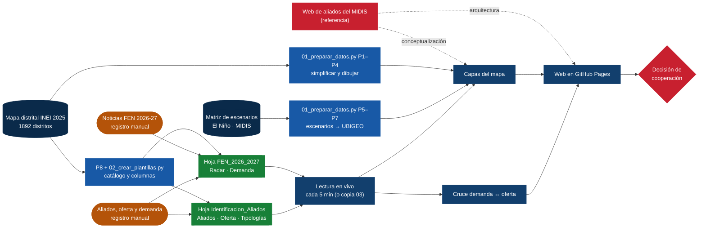

# Aliados y cooperación ante el Fenómeno El Niño 2026-2027 · EsSalud

Web de la oficina de cooperación internacional de EsSalud para buscar cooperación ante el FEN 2026-2027. Responde a una decisión: **a qué aliado pedir qué apoyo, y para qué zona**.

> **Referencia.** La arquitectura y la conceptualización de esta web siguen el **[Mapa de Aliados Estratégicos ante emergencias y Fenómeno El Niño del MIDIS](https://claude.ai/artifact/XCFnRvFZUEnCZ79exZgucG)**. De esa web vienen la estructura de secciones, el mapa con aliados por departamento, el filtro por tipología, las tipologías Donante, Voluntario, Logístico y Articulador, los niveles de emergencia del SINAGERD y la lectura en vivo desde Google Sheets. Se reconoce como el modelo que se siguió.

## Qué muestra

| Sección | Qué contiene | De dónde sale |
| --- | --- | --- |
| Mapa | Perú con 1892 distritos. Capas: **FEN histórico** (azul) y **FEN 2026-27** (naranja); franjas cuando un distrito tiene ambas. Círculos con el número de aliados por departamento. | Mapa INEI 2025, matriz de escenarios y hojas de Google |
| FEN histórico | 23 escenarios: zonas que suelen ser las más afectadas por El Niño | `Matriz_Escenarios_El_Nino_2026-2027_MIDIS.xlsx` |
| Radar 2026-27 | Noticias sobre dónde está afectando el FEN 2026-27 | Hoja [FEN_2026_2027](https://docs.google.com/spreadsheets/d/1YE-9gXDLxJOuHyfflAFxznstzzi1sihIF3RiLt6zp5c/edit) › Radar |
| Demanda | Necesidades de cooperación por zona y aliados cuya oferta coincide | Hoja FEN_2026_2027 › Demanda + oferta de aliados |
| Aliados | Directorio con tipologías, oferta y cobertura | Hoja [Identificacion_Aliados_Essalud](https://docs.google.com/spreadsheets/d/1NYboI4a8f3SYIUpmPrKBunqqmcSTwwL6GylItubkLIE/edit) › Aliados y Oferta |
| Niveles y Tipologías | Niveles SINAGERD y definiciones de cada tipo de aliado | Web del MIDIS + pestaña Tipologias |
| Pipeline | Diagrama del flujo de datos al estilo n8n | Esta documentación |

## Pipeline

En la web, la sección **Cómo funciona** dibuja este mismo flujo al estilo n8n, con nodos y cables, y cada nodo enlaza a su archivo o a su hoja.



## Mapa de procesos

| N.º | Proceso | Insumo | Método | Resultado |
| --- | --- | --- | --- | --- |
| P1 | Cargar el mapa distrital | `peru_distritos_1892_2025.gpkg` | Lectura con geopandas y paso a metros (UTM 18S) | Tabla de 1892 distritos |
| P2 | Simplificar contornos | 1,7 millones de vértices | `coverage_simplify` a ~200 m, sin huecos entre vecinos | 262 mil vértices |
| P3 | Formar departamentos | Distritos simplificados | Unión por código de departamento | 25 polígonos |
| P4 | Convertir a trazos SVG | Distritos y departamentos | Coordenadas enteras (1 unidad = 100 m) | `datos/mapa.json` (1,7 MB) |
| P5 | Leer la matriz de escenarios | Hoja «Matriz» del Excel | Lectura con openpyxl | 23 escenarios |
| P6 | Vincular escenarios con distritos | `datos/fuentes/escenarios_lugares.csv` (escrito a mano) | Comparación de nombres sin tildes; si no está en la provincia, se busca en el departamento | 766 vínculos, 753 distritos |
| P7 | Exportar la capa FEN histórico | Escenarios + vínculos | Unión de tablas | `datos/fen_historico.json` y `fen_historico_distritos.csv` |
| P8 | Catálogo de lugares | Códigos y nombres INEI | Etiqueta jerárquica con el código al final | `datos/catalogo_lugares.csv` (2114 lugares) |
| P9 | Crear las plantillas de las hojas | Columnas, listas y catálogo | openpyxl con listas desplegables y notas | `plantillas/*.xlsx` (importadas a Google Sheets) |
| P10 | Copia de respaldo de las hojas | Hojas de Google | Descarga CSV (gviz) | `datos/copia/*.csv` |
| W3 | Lectura en vivo | Hojas de Google | `fetch` del CSV de cada pestaña al abrir y cada 5 min | Radar, demanda, aliados, oferta |
| W4 | Cruces | Datos leídos | Código del lugar → distritos; demanda ↔ oferta por categoría y lugar | Capas y posibles aliados |
| W5–W8 | Representación | Todo lo anterior | Mapa SVG con zoom, panel, secciones y pipeline | La web |

P1 a P8 están en `scripts/01_preparar_datos.py`, P9 en `02_crear_plantillas.py`, P10 en `03_copiar_hojas.py` y W3 a W9 en `assets/app.js`.

## Fuentes

| Fuente | Quién la produce | Cobertura | Notas |
| --- | --- | --- | --- |
| Límites distritales Censo 2025 | INEI (redistribuido por geogpsperu.com, jul. 2026) | 1892 distritos, WGS84 | Límites referenciales, no legales (los legales los aprueba la PCM). Copia en `G:\Mi unidad\1_Comun\14_Mapa_Peru_Distrito`, con su LEEME |
| Matriz de escenarios El Niño 2026-2027 | MIDIS, 28/09/2026, con datos de ENFEN, NOAA, CENEPRED, INDECI, MINSA | 23 escenarios en 25 departamentos | Probabilidad y riesgo de pérdida de vidas son juicio analítico. Los distritos son «probables» por exposición histórica, no una lista oficial. No se publica la columna «Implicancias para MIDIS» |
| Radar, demanda, aliados y oferta | Oficina de cooperación internacional de EsSalud | Se llena con el tiempo | Hojas compartidas como lector: no registrar datos personales |

## Decisiones de preprocesamiento (capa FEN histórico)

La columna «Provincias / distritos probables» de la matriz es texto libre. Se convirtió en la tabla `datos/fuentes/escenarios_lugares.csv`, una fila por lugar, con una nota cada vez que hubo que interpretar el texto. Puedes revisarla y corregirla; luego vuelve a ejecutar `01_preparar_datos.py`.

- **753 distritos** marcados (766 vínculos escenario-distrito). Solo **135 están nombrados uno por uno** en la matriz. El resto entra porque la matriz nombra una provincia o un departamento completo, por ejemplo las 10 provincias de Puno, cuando la matriz habla de 29 distritos sin listarlos. La web tiene la casilla «Solo distritos nombrados en la matriz» para ver solo los 135.
- Nombres corregidos según el INEI: Tambogrande → Tambo Grande, Zaña → Saña, Víctor Larco → Víctor Larco Herrera.
- Provincia corregida: Cristo Nos Valga está en la provincia Sechura, no en Piura (escenario 2), y Ocoña está en Camaná, no en Caravelí (escenario 14).
- Sin ubicar en el mapa: «provincias de Conchucos» (escenario 10), «Huancavelica: 5» (19), «caletas artesanales de Tumbes a Tacna» (21) y el escenario 22 completo (toda la costa urbana).
- Lugares que son ciudades: Pucallpa → distrito Callería, Matarani → distrito Islay, Parachique → distrito Sechura, «Cajamarca (laderas)» → distrito Cajamarca.

## Bases de datos en Google Sheets

| Hoja | Pestañas | Uso |
| --- | --- | --- |
| [FEN_2026_2027](https://docs.google.com/spreadsheets/d/1YE-9gXDLxJOuHyfflAFxznstzzi1sihIF3RiLt6zp5c/edit) | LEEME, Radar, Demanda, Listas, Lugares | Radar de noticias y demanda de cooperación por zona |
| [Identificacion_Aliados_Essalud](https://docs.google.com/spreadsheets/d/1NYboI4a8f3SYIUpmPrKBunqqmcSTwwL6GylItubkLIE/edit) | LEEME, Aliados, Oferta, Tipologias, Listas, Lugares | Aliados, su oferta y las definiciones de tipología |

- **Una fila = un registro en un lugar.** Si una noticia u oferta abarca varios lugares, se repite la fila con el mismo código.
- **El lugar se elige del desplegable.** Termina en el código entre paréntesis, por ejemplo `PIURA › SULLANA › BELLAVISTA (200602)`: 2 dígitos = departamento, 4 = provincia, 6 = distrito, `00` = todo el país. Ese código ubica la fila en el mapa.
- **La categoría de la demanda y la de la oferta usan la misma lista.** Así la web propone posibles aliados para cada necesidad.
- **No cambiar los nombres de pestañas ni de columnas:** la web los busca por nombre. Se pueden agregar columnas al final.
- **Las hojas son visibles con el enlace.** No registrar nombres, correos ni teléfonos de personas.

## Cómo actualizar

Requisitos: Anaconda (Python 3 con geopandas, shapely 2.1 o superior, pandas y openpyxl).

```bash
python scripts/01_preparar_datos.py      # solo si cambia el mapa o la matriz
python scripts/02_crear_plantillas.py    # solo si cambian columnas o listas (luego reimportar en Sheets)
python scripts/03_copiar_hojas.py        # copia de respaldo de las hojas (opcional)
python -m http.server 8000               # ver la web en http://localhost:8000
```

Si los archivos de origen están en otra ruta: `python scripts/01_preparar_datos.py --mapa "<ruta .gpkg>" --matriz "<ruta .xlsx>"`.

Para cambiar las columnas de una hoja: edita `02_crear_plantillas.py`, ejecútalo y, en la hoja, usa **Archivo › Importar › Subir › Reemplazar hoja de cálculo**. Ojo: esto borra lo registrado, así que antes copia los datos.

## Estructura

```
index.html                 página
assets/estilos.css         estilos (modo claro y oscuro)
assets/app.js              lógica de la web (W1–W9)
assets/fondo.svg           imagen de fondo neutra (curvas de nivel)
datos/mapa.json            mapa distrital (P4)
datos/fen_historico.json   capa FEN histórico (P7)
datos/fen_historico_distritos.csv   vínculos escenario-distrito, para revisar
datos/catalogo_lugares.csv lista de lugares de los desplegables (P8)
datos/fuentes/escenarios_lugares.csv  tabla manual escenario → lugares
datos/copia/*.csv          copia de respaldo de las hojas (P10)
plantillas/*.xlsx          estructura de las dos hojas (P9)
scripts/01…03_*.py         procesos numerados
CLAUDE.md                  contexto para continuar con Claude Code en otra computadora
```

## Limitaciones y pendientes

- La capa FEN histórico depende de cómo la matriz describe los lugares: cuando nombra provincias o departamentos completos, el mapa sobrestima el área. Por eso existe el filtro «Solo distritos nombrados».
- Cuando la matriz nombra una ciudad, se marca su distrito completo. En la Amazonía eso agranda mucho el área: «Pucallpa» (dengue, escenario 23) pinta todo el distrito Callería, de unos 11 000 km².
- Las probabilidades de la matriz son juicio analítico, no un pronóstico oficial.
- Los límites distritales son referenciales (INEI).
- Pendiente: logo institucional, activar GitHub Pages (Settings › Pages › rama `main`), llenar las hojas y revisar la tabla `escenarios_lugares.csv`.
